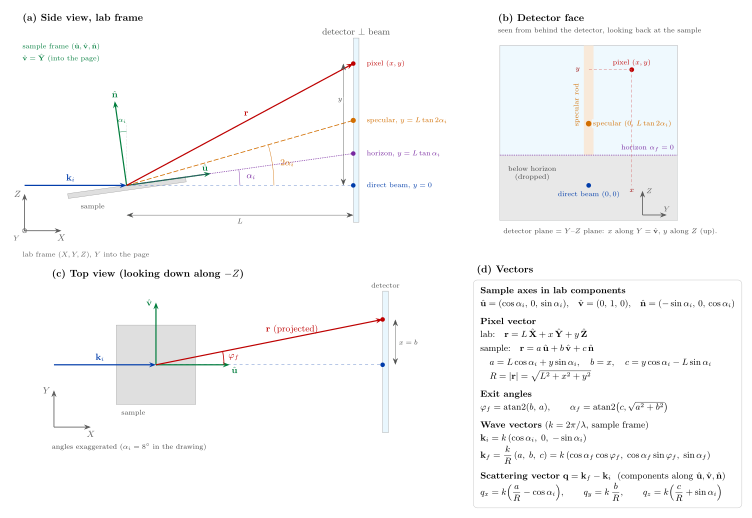

# GISAXS pixel converter



A static web app that takes a GISAXS detector frame (`.dat`) and its BornAgain
instrument file (`.pro`), converts every detector pixel to exit angles, final
wavevector and scattering vector, masks the specular rod or spot, and plots 2D
maps and 1D profiles that download as PNG or PDF.

All analysis runs **in the browser, in Python**, through
[Pyodide](https://pyodide.org/) (numpy, pandas, matplotlib). Plotly.js draws the
interactive on-screen plots. There is no server: the files you choose never
leave your computer, and the site is plain static files on GitHub Pages.

## What it does

The page is a sequence of numbered steps that unlock in order:

1. **Upload** the `.dat` and `.pro` files (drop both at once or pick them).
2. **Instrument parameters** from the `.pro` file, plus the derived distance
   $L = |\mathbf N|$, pixel pitch, $k = 2\pi/\lambda$ and the angular size of one
   pixel. The collapsible **Geometry & equations** panel shows the schematic and
   every formula below.
3. **Raw data**: the first rows (`df.head()`), pixel count, grid, pixel order
   check, dead and zero pixels.
4. **Raw intensity map** (optional): y vs x over the full detector.
5. **Exit angles** $(x, y) \to (\varphi_f, \alpha_f)$.
6. **Final wavevector** $k_{fx}, k_{fy}, k_{fz}$.
7. **Scattering vector** $q_x, q_y, q_z$.
8. **Horizon cut**: whole detector rows below the sample horizon are dropped, so
   the data stays a rectangular image (the beamstop goes with them).
9. **Converted table** and download as `.csv.gz` (default) or plain `.csv`.
10. **Mask the specular rod?** with `mask.py` (`find_rod`, `mask_rod`), width
    $n_\sigma\sigma$ (default 4) or a fixed half-width in degrees.
11. **Mask the specular spot?** (only if the rod was not masked) with `spot.py`.
12. **2D maps**: $q_z$ vs $q_y$, $\alpha_f$ vs $\varphi_f$, $y$ vs $x$. Every
    pixel is one point coloured by its counts; no averaging, no regridding.
13. **1D profiles**: mean counts per pixel vs $\varphi_f$, $q_y$, $\alpha_f$, $q_z$.
14. **Download** any plot as PNG or PDF, drawn by matplotlib in a publication
    or presentation style.

Steps 5 to 8 run with one click (the conversion of about one million pixels takes
under a second). Display options (log scale, colormap, colour range, point size)
are applied in JavaScript and never re-run the conversion; masks and the q unit
re-fetch only the arrays they change.

## How to use it

1. Open the site and wait for "Python ready" in the status bar (the first visit
   downloads Pyodide, numpy, pandas and matplotlib from `cdn.jsdelivr.net`, about
   30 MB; later visits come from the browser cache).
2. Drop the `.dat` and `.pro` files on the page.
3. Click **Convert (runs steps 5–8)**, then answer the two mask questions.
4. Tick the maps and profiles you want. Zoom with the mouse; the hover label
   shows the coordinates and the real counts.
5. Pick the export style at the top (**Publication**, 1 or 2 journal columns, or
   **Presentation / projector**) and the q unit (nm⁻¹ or Å⁻¹), then download.

Everything after the first load works offline; only the CDN downloads need the
network.

## Frames and equations

Three coordinate systems are used, with the same names in the code, the UI and
here:

| system | axes | meaning |
|---|---|---|
| **lab frame** | $X, Y, Z$ | $X$ along the incident beam, $Z$ vertical up, $Y = Z \times X$ (horizontal) |
| **sample frame** | $\hat{\mathbf u}, \hat{\mathbf v}, \hat{\mathbf n}$ | $\hat{\mathbf u}$ in the surface along the beam, $\hat{\mathbf v} = \hat{\mathbf Y}$ in the surface, $\hat{\mathbf n}$ the surface normal |
| **detector** | $x, y$ | position on the detector in mm, measured from the direct beam; the detector plane is the $Y$–$Z$ plane: $x$ along $Y$, $y$ along $Z$ (up) |

The sample is tilted by $\alpha_i$ about $Y$, so in lab components

$$
\hat{\mathbf u}=(\cos\alpha_i,\ 0,\ \sin\alpha_i),\qquad
\hat{\mathbf v}=(0,\ 1,\ 0),\qquad
\hat{\mathbf n}=(-\sin\alpha_i,\ 0,\ \cos\alpha_i)
$$

**All results ($\varphi_f$, $\alpha_f$, $\mathbf k_f$, $\mathbf q$) are in the
sample frame**: the components written $x, y, z$ ($k_{fx}$, $q_x$, …) are the
components along $\hat{\mathbf u}, \hat{\mathbf v}, \hat{\mathbf n}$.

**Pixel position.** The vector from the sample to the pixel is

$$
\mathbf r = L\,\hat{\mathbf X} + x\,\hat{\mathbf Y} + y\,\hat{\mathbf Z}
= a\,\hat{\mathbf u} + b\,\hat{\mathbf v} + c\,\hat{\mathbf n}
$$

$$
a = L\cos\alpha_i + y\sin\alpha_i,\qquad
b = x,\qquad
c = y\cos\alpha_i - L\sin\alpha_i,\qquad
R = \sqrt{L^2 + x^2 + y^2} = \sqrt{a^2 + b^2 + c^2}
$$

**Exit angles.**

$$
\varphi_f = \operatorname{atan2}(b,\ a),\qquad
\alpha_f = \operatorname{atan2}\left(c,\ \sqrt{a^2+b^2}\right)
$$

**Wavevectors.**

$$
k = \frac{2\pi}{\lambda},\qquad
\mathbf k_f = \frac{k}{R}\,(a,\ b,\ c),\qquad
\mathbf k_i = k\,(\cos\alpha_i,\ 0,\ -\sin\alpha_i)
$$

**Scattering vector** $\mathbf q = \mathbf k_f - \mathbf k_i$:

$$
q_x = k\left(\frac{a}{R} - \cos\alpha_i\right),\qquad
q_y = k\,\frac{b}{R},\qquad
q_z = k\left(\frac{c}{R} + \sin\alpha_i\right)
$$

or equivalently $q_x = k(\cos\alpha_f\cos\varphi_f - \cos\alpha_i)$,
$q_y = k\cos\alpha_f\sin\varphi_f$, $q_z = k(\sin\alpha_f + \sin\alpha_i)$. The
code uses the $a/R, b/R, c/R$ form, vectorised with numpy.

**Special positions** (used in the tests):

| feature | condition | detector position |
|---|---|---|
| direct beam | $\alpha_f = -\alpha_i,\ \varphi_f = 0$ | $x = 0,\ y = 0$ |
| sample horizon | $\alpha_f = 0$ | $y = L\tan\alpha_i$ |
| specular spot | $\alpha_f = \alpha_i,\ \varphi_f = 0$ | $x = 0,\ y = L\tan 2\alpha_i$ |

**Horizon cut.** For each detector row, $\alpha_{f,\text{row}} = \operatorname{atan2}(c, a)$
at $x = 0$; rows with $\alpha_{f,\text{row}} < 0$ are dropped whole. The test
file keeps 925 × 1028 = 950,900 pixels.

### Assumptions and conventions

- The **detector is perpendicular to the incident beam** at distance
  $L = |\mathbf N|$. Only the length of the `.pro` normal vector $\mathbf N$ is
  used, not its direction or $u_0, v_0$.
- `x` and `y` in the `.dat` file are **measured from the direct beam**.
- **$\varphi_f$ increases with $x$.** BornAgain uses the opposite sign for
  $\varphi_f$ and $q_y$; this app does not.
- Angles are shown and exported in degrees (trigonometry in radians). $k$ and
  $q$ are in nm⁻¹ because $\lambda$ is in nm; the toggle switches tables, plots
  and exports to Å⁻¹ (× 0.1).
- The pixel order of the `.dat` file is **verified**, not assumed: row-major,
  bottom row first, x ascending within a row. Any other regular order is sorted
  into it; an irregular grid is an error.
- Counts of −1 (dead pixels) become NaN on reading, and so does their variance.
  NaN already in the file is kept as NaN.

## Masks

**Specular rod** (`py/mask.py`, provided): the column sums are profiled against
$\varphi_f$, the tallest peak is measured (centre of mass of its top half, FWHM
→ σ), and every pixel within $n_\sigma\sigma$ of the centre gets intensity and
variance NaN. The report repeats mask.py's check: the tallest column left
standing against the diffuse level just outside the mask.

**Specular spot** (`py/spot.py`): a window of ±W pixel widths (default 15) around
the predicted position $\varphi_f = 0,\ \alpha_f = \alpha_i$; the window is
averaged over its rows, $P(\varphi_f)$, and its columns, $Q(\alpha_f)$. For each
profile: background B = median of the outer 20 % of the window, height
H = max − B, FWHM from the two half-maximum crossings found by linear
interpolation, σ = FWHM / (2√(2 ln 2)), centre = centroid of (P − B) over the
points above H/2. Every pixel inside

$$
\left(\frac{\varphi_f-\varphi_0}{n\,\sigma_\varphi}\right)^2+
\left(\frac{\alpha_f-\alpha_0}{n\,\sigma_\alpha}\right)^2\le 1
$$

is masked (n default 4). A FWHM narrower than one pixel is replaced by one pixel.

> **Note on the test file.** In `frame-000.dat` the specular spot is at
> $\alpha_f \approx 0.426°$ (y ≈ 20.3 mm), not at $\alpha_i = 0.300°$
> (y = 16.8 mm): 47 pixels away, outside the default ±15-pixel window. With the
> defaults the spot measurement therefore stops with a message that names the
> brightest pixel nearby. Tick **Follow the peak** to let the window climb to the
> local maximum and centre on it, or enlarge W. The window centre and how far it
> moved are shown in the report.

## Plots and exports

- **Colour scale.** The data are never transformed: log scaling is applied to
  the display only. Measured zeros (about 96 % of the pixels) are drawn in a
  dedicated "under" colour (black, or white if selected); NaN pixels (dead or
  masked) in plotstyle's grey "bad" colour. Defaults: vmin = 1 count, vmax = the
  maximum of the unmasked data; both can be set by hand.
- **Colormaps**: viridis (default), cividis, inferno, magma, turbo. The Plotly
  colour scales are sampled from the same matplotlib colormaps, so screen and
  file match.
- **On screen** the maps are Plotly `scattergl` (WebGL) with one square marker
  per pixel; the point size follows the zoom so a pixel stays about one pixel.
  The colour bar is labelled in real counts (1, 10, 10², …) and the hover label
  shows the real count. The profiles have Origin-style crosshair spike lines.
- **Files** are drawn by matplotlib with `plotstyle.use_publication_style(engine="stix")`
  (STIXGeneral, since LaTeX and Times New Roman are not available in the
  browser). *Publication*: plotstyle defaults, 1 or 2 journal columns.
  *Presentation / projector*: `font_size=16`, `linewidth=1.5`, 2 pt lines,
  8 × 6 in. In 2D maps the scatter layer is rasterised (600 dpi); axes, labels
  and colour bar stay vector.
- **File names** use the `.dat` stem and the plot, e.g.
  `frame-000_qz-vs-qy.pdf`, `frame-000_profile-vs-alphaf.png`,
  `frame-000_converted.csv.gz`.

### The exported table

Columns (with `_A-1` instead of `_nm-1` when Å⁻¹ is selected):

```
x_mm, y_mm, counts, variance, phi_f_deg, alpha_f_deg,
kfx_nm-1, kfy_nm-1, kfz_nm-1, qx_nm-1, qy_nm-1, qz_nm-1
```

Numbers have 8 significant digits, NaN is written `nan`, and a `#` header records
the file names, L, αᵢ, λ, k, pixel pitch, grid, q unit, date, the horizon cut
and any mask. It loads with

```python
import pandas as pd
df = pd.read_csv("frame-000_converted.csv.gz", comment="#")
```

For the 1 Mpixel test frame the `.csv.gz` is about 31 MB and the plain `.csv`
about 108 MB. After a mask is applied, the masked table can be downloaded from
step 10 or 11.

## Deployment (GitHub Pages)

1. Push this folder to a GitHub repository.
2. Settings → Pages → Source: *Deploy from a branch*, branch `main`, folder
   `/ (root)`.
3. Open `https://<user>.github.io/<repo>/`.

There is no build step. All paths are relative, so the site works under
`/<repo>/`, and the empty `.nojekyll` file makes GitHub Pages serve every file
as-is.

## Run the tests

```bash
pip install numpy pandas matplotlib pytest
pytest tests/
```

The tests check the conversion against the toy geometry of the spec (L = 86 mm,
αᵢ = 1°, λ = 0.15406 nm), the direct-beam, horizon and specular positions,
$|\mathbf k_f| = k$, the horizon cut, the profiles, the spot mask, the CSV round
trip, the figures, and (when `test_data/` is present) the real files end to end,
including 925 × 1028 pixels after the horizon cut and the browser command layer
(`py/bridge.py`).

## Preview locally

```bash
python -m http.server
```

Run it in the repository folder, then open <http://localhost:8000>. Opening
`index.html` directly from disk does not work, because the page fetches the
Python files and starts a Web Worker.

## Files

```
index.html            the page (loads Pyodide, Plotly and KaTeX from cdn.jsdelivr.net, pinned)
css/style.css
js/app.js             UI, file upload, Plotly rendering, downloads
js/worker.js          Pyodide in a module Web Worker
py/read_pro.py        provided, unchanged: reads the .pro file
py/mask.py            provided, unchanged: specular-rod mask
py/plotstyle.py       provided, unchanged: matplotlib publication style
py/gisaxs.py          parsing, conversion, horizon cut, profiles, CSV export
py/spot.py            specular-spot mask
py/figures.py         matplotlib PNG/PDF export using plotstyle
py/bridge.py          session state and the commands the worker calls
tests/test_gisaxs.py  pytest, plain CPython
assets/geometry.svg   schematic (also geometry.png)
docs/geometry.pdf, docs/geometry.tex
test_data/            the example measurement used by the integration tests
```

Pinned versions: Pyodide 314.0.7 (Python 3.14, numpy 2.4.6, pandas 3.0.2,
matplotlib 3.10.8), Plotly.js 4.1.1, KaTeX 0.18.9. The worker is a module
worker, so current Chrome, Edge, Firefox (114+) and Safari (15+) are supported.
